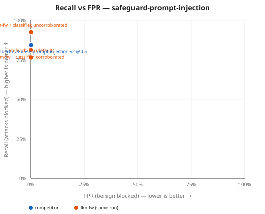
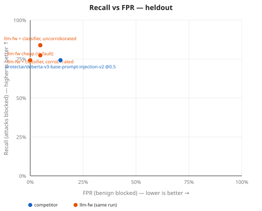
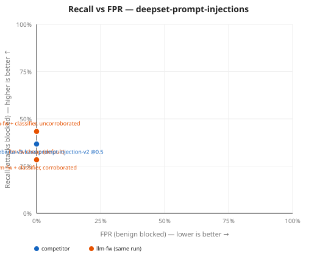
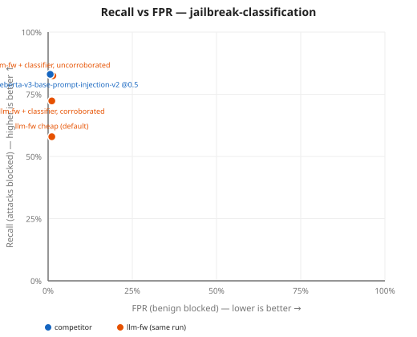
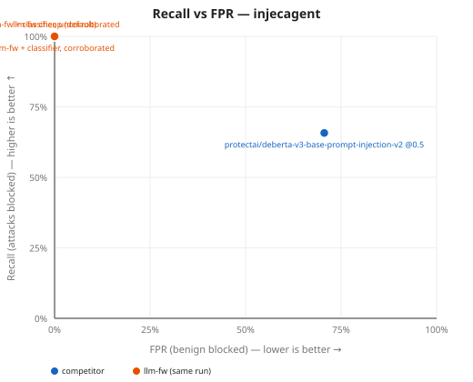
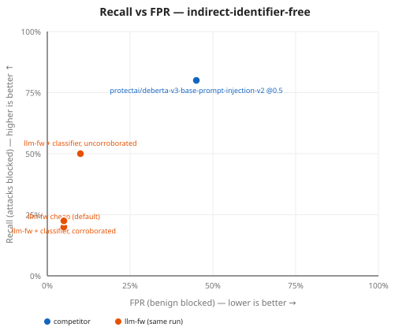

[llm-fw](../README.md) > [Documentation](README.md) > Measurements > Competitor guardrail head-to-head

# Competitor guardrail head-to-head

Generated 2026-11-10 on ruleset 2026.11.50 by `npm run bench:competitors`. Do not edit by hand.

Third-party prompt-injection guardrails and llm-fw on the same rows of the same splits (see [BENCHMARK.md](BENCHMARK.md) for what each split is). Recall is attacks blocked, FPR is benign rows blocked, and the counts behind each rate are in brackets. A split with no attack rows has no recall and one with no benign rows has no FPR. Direct injection, indirect injection and benign-only traffic are separate tables and are never averaged.

Every row is measured in the run that generated this page, the llm-fw rows included (in bold). Two differences in how a row reaches each guardrail are part of what is compared:

- **llm-fw gets each row on the surface it arrives on** (user prompt, tool result, system prompt, tool definition), inside an Anthropic Messages request, because that is what a proxy sees. A standalone classifier has no notion of a surface and gets the text alone.
- **`protectai/deberta-v3-base-prompt-injection-v2` is also the model behind llm-fw's opt-in classifier stage.** Its own row is that model alone at its natural 0.5 threshold. The "llm-fw + classifier" rows are the default pipeline with the same model added at 0.9: "corroborated" is what turning the classifier on gives (a classifier hit blocks only when the heuristic or embedding stage found the text suspicious too), "uncorroborated" sets `detection.classifier.requireCorroboration` to false.

### safeguard-prompt-injection (injection, n=2060)

| Guardrail | Recall | FPR | Status |
|---|---|---|---|
| **llm-fw cheap (default)** | 76.6% (498/650) | 0.1% (1/1410) | ran |
| **llm-fw + classifier, corroborated** | 81.1% (527/650) | 0.1% (1/1410) | ran |
| **llm-fw + classifier, uncorroborated** | 92.6% (602/650) | 0.1% (2/1410) | ran |
| protectai/deberta-v3-base-prompt-injection-v2 @0.5 | 84.3% (548/650) | 0.1% (2/1410) | ran |
| meta-llama/Prompt-Guard-86M | — | — | not run: gated model (accept the Meta license at huggingface.co and set HF_TOKEN) |
| llama-guard-3 (ollama:llama-guard3) | — | — | not run: Ollama unreachable (fetch failed) |
| lakera-guard (hosted API) | — | — | not run: LAKERA_API_KEY not set |



### heldout (injection, n=52)

| Guardrail | Recall | FPR | Status |
|---|---|---|---|
| **llm-fw cheap (default)** | 74.2% (23/31) | 0.0% (0/21) | ran |
| **llm-fw + classifier, corroborated** | 77.4% (24/31) | 4.8% (1/21) | ran |
| **llm-fw + classifier, uncorroborated** | 83.9% (26/31) | 4.8% (1/21) | ran |
| protectai/deberta-v3-base-prompt-injection-v2 @0.5 | 74.2% (23/31) | 14.3% (3/21) | ran |
| meta-llama/Prompt-Guard-86M | — | — | not run: gated model (accept the Meta license at huggingface.co and set HF_TOKEN) |
| llama-guard-3 (ollama:llama-guard3) | — | — | not run: Ollama unreachable (fetch failed) |
| lakera-guard (hosted API) | — | — | not run: LAKERA_API_KEY not set |



### gandalf-ignore-instructions (injection, n=112)

| Guardrail | Recall | FPR | Status |
|---|---|---|---|
| **llm-fw cheap (default)** | 87.5% (98/112) | — | ran |
| **llm-fw + classifier, corroborated** | 89.3% (100/112) | — | ran |
| **llm-fw + classifier, uncorroborated** | 100.0% (112/112) | — | ran |
| protectai/deberta-v3-base-prompt-injection-v2 @0.5 | 100.0% (112/112) | — | ran |
| meta-llama/Prompt-Guard-86M | — | — | not run: gated model (accept the Meta license at huggingface.co and set HF_TOKEN) |
| llama-guard-3 (ollama:llama-guard3) | — | — | not run: Ollama unreachable (fetch failed) |
| lakera-guard (hosted API) | — | — | not run: LAKERA_API_KEY not set |

### deepset-prompt-injections (injection, n=116)

| Guardrail | Recall | FPR | Status |
|---|---|---|---|
| **llm-fw cheap (default)** | 28.3% (17/60) | 0.0% (0/56) | ran |
| **llm-fw + classifier, corroborated** | 28.3% (17/60) | 0.0% (0/56) | ran |
| **llm-fw + classifier, uncorroborated** | 43.3% (26/60) | 0.0% (0/56) | ran |
| protectai/deberta-v3-base-prompt-injection-v2 @0.5 | 36.7% (22/60) | 0.0% (0/56) | ran |
| meta-llama/Prompt-Guard-86M | — | — | not run: gated model (accept the Meta license at huggingface.co and set HF_TOKEN) |
| llama-guard-3 (ollama:llama-guard3) | — | — | not run: Ollama unreachable (fetch failed) |
| lakera-guard (hosted API) | — | — | not run: LAKERA_API_KEY not set |



### jailbreak-classification (injection, n=1179)

| Guardrail | Recall | FPR | Status |
|---|---|---|---|
| **llm-fw cheap (default)** | 57.9% (314/542) | 1.1% (7/637) | ran |
| **llm-fw + classifier, corroborated** | 72.3% (392/542) | 1.1% (7/637) | ran |
| **llm-fw + classifier, uncorroborated** | 82.5% (447/542) | 1.4% (9/637) | ran |
| protectai/deberta-v3-base-prompt-injection-v2 @0.5 | 83.0% (450/542) | 0.6% (4/637) | ran |
| meta-llama/Prompt-Guard-86M | — | — | not run: gated model (accept the Meta license at huggingface.co and set HF_TOKEN) |
| llama-guard-3 (ollama:llama-guard3) | — | — | not run: Ollama unreachable (fetch failed) |
| lakera-guard (hosted API) | — | — | not run: LAKERA_API_KEY not set |



### multilingual-injections (injection, n=974)

| Guardrail | Recall | FPR | Status |
|---|---|---|---|
| **llm-fw cheap (default)** | 28.3% (276/974) | — | ran |
| **llm-fw + classifier, corroborated** | 33.2% (323/974) | — | ran |
| **llm-fw + classifier, uncorroborated** | 97.8% (953/974) | — | ran |
| protectai/deberta-v3-base-prompt-injection-v2 @0.5 | 98.2% (956/974) | — | ran |
| meta-llama/Prompt-Guard-86M | — | — | not run: gated model (accept the Meta license at huggingface.co and set HF_TOKEN) |
| llama-guard-3 (ollama:llama-guard3) | — | — | not run: Ollama unreachable (fetch failed) |
| lakera-guard (hosted API) | — | — | not run: LAKERA_API_KEY not set |

### injecagent (indirect-injection, n=1071)

| Guardrail | Recall | FPR | Status |
|---|---|---|---|
| **llm-fw cheap (default)** | 100.0% (1054/1054) | 0.0% (0/17) | ran |
| **llm-fw + classifier, corroborated** | 100.0% (1054/1054) | 0.0% (0/17) | ran |
| **llm-fw + classifier, uncorroborated** | 100.0% (1054/1054) | 0.0% (0/17) | ran |
| protectai/deberta-v3-base-prompt-injection-v2 @0.5 | 65.7% (693/1054) | 70.6% (12/17) | ran |
| meta-llama/Prompt-Guard-86M | — | — | not run: gated model (accept the Meta license at huggingface.co and set HF_TOKEN) |
| llama-guard-3 (ollama:llama-guard3) | — | — | not run: Ollama unreachable (fetch failed) |
| lakera-guard (hosted API) | — | — | not run: LAKERA_API_KEY not set |



### indirect-identifier-free (indirect-injection, n=60)

| Guardrail | Recall | FPR | Status |
|---|---|---|---|
| **llm-fw cheap (default)** | 20.0% (8/40) | 5.0% (1/20) | ran |
| **llm-fw + classifier, corroborated** | 22.5% (9/40) | 5.0% (1/20) | ran |
| **llm-fw + classifier, uncorroborated** | 50.0% (20/40) | 10.0% (2/20) | ran |
| protectai/deberta-v3-base-prompt-injection-v2 @0.5 | 80.0% (32/40) | 45.0% (9/20) | ran |
| meta-llama/Prompt-Guard-86M | — | — | not run: gated model (accept the Meta license at huggingface.co and set HF_TOKEN) |
| llama-guard-3 (ollama:llama-guard3) | — | — | not run: Ollama unreachable (fetch failed) |
| lakera-guard (hosted API) | — | — | not run: LAKERA_API_KEY not set |



### benign-realistic (injection, n=356)

| Guardrail | Recall | FPR | Status |
|---|---|---|---|
| **llm-fw cheap (default)** | — | 2.0% (7/356) | ran |
| **llm-fw + classifier, corroborated** | — | 3.1% (11/356) | ran |
| **llm-fw + classifier, uncorroborated** | — | 24.2% (86/356) | ran |
| protectai/deberta-v3-base-prompt-injection-v2 @0.5 | — | 30.9% (110/356) | ran |
| meta-llama/Prompt-Guard-86M | — | — | not run: gated model (accept the Meta license at huggingface.co and set HF_TOKEN) |
| llama-guard-3 (ollama:llama-guard3) | — | — | not run: Ollama unreachable (fetch failed) |
| lakera-guard (hosted API) | — | — | not run: LAKERA_API_KEY not set |

### dolly-15k-sample (injection, n=2000)

| Guardrail | Recall | FPR | Status |
|---|---|---|---|
| **llm-fw cheap (default)** | — | 0.0% (0/2000) | ran |
| **llm-fw + classifier, corroborated** | — | 0.0% (0/2000) | ran |
| **llm-fw + classifier, uncorroborated** | — | 0.1% (2/2000) | ran |
| protectai/deberta-v3-base-prompt-injection-v2 @0.5 | — | 0.1% (2/2000) | ran |
| meta-llama/Prompt-Guard-86M | — | — | not run: gated model (accept the Meta license at huggingface.co and set HF_TOKEN) |
| llama-guard-3 (ollama:llama-guard3) | — | — | not run: Ollama unreachable (fetch failed) |
| lakera-guard (hosted API) | — | — | not run: LAKERA_API_KEY not set |

### oasst1-sample (injection, n=2000)

| Guardrail | Recall | FPR | Status |
|---|---|---|---|
| **llm-fw cheap (default)** | — | 0.0% (0/2000) | ran |
| **llm-fw + classifier, corroborated** | — | 0.1% (2/2000) | ran |
| **llm-fw + classifier, uncorroborated** | — | 11.8% (237/2000) | ran |
| protectai/deberta-v3-base-prompt-injection-v2 @0.5 | — | 13.6% (272/2000) | ran |
| meta-llama/Prompt-Guard-86M | — | — | not run: gated model (accept the Meta license at huggingface.co and set HF_TOKEN) |
| llama-guard-3 (ollama:llama-guard3) | — | — | not run: Ollama unreachable (fetch failed) |
| lakera-guard (hosted API) | — | — | not run: LAKERA_API_KEY not set |

### aya-sample (injection, n=2795)

| Guardrail | Recall | FPR | Status |
|---|---|---|---|
| **llm-fw cheap (default)** | — | 0.0% (0/2795) | ran |
| **llm-fw + classifier, corroborated** | — | 0.0% (1/2795) | ran |
| **llm-fw + classifier, uncorroborated** | — | 41.5% (1160/2795) | ran |
| protectai/deberta-v3-base-prompt-injection-v2 @0.5 | — | 47.9% (1339/2795) | ran |
| meta-llama/Prompt-Guard-86M | — | — | not run: gated model (accept the Meta license at huggingface.co and set HF_TOKEN) |
| llama-guard-3 (ollama:llama-guard3) | — | — | not run: Ollama unreachable (fetch failed) |
| lakera-guard (hosted API) | — | — | not run: LAKERA_API_KEY not set |

## Adapters not run

- **meta-llama/Prompt-Guard-86M** — not run: gated model (accept the Meta license at huggingface.co and set HF_TOKEN)
- **llama-guard-3 (ollama:llama-guard3)** — not run: Ollama unreachable (fetch failed)
- **lakera-guard (hosted API)** — not run: LAKERA_API_KEY not set

## Reproduce

```
npm run bench:competitors
```

Runs each split in its own subprocess with an enlarged heap (`--max-old-space-size=8192`), one guardrail at a time, so a local ONNX model load cannot run a single long-lived process out of memory.
